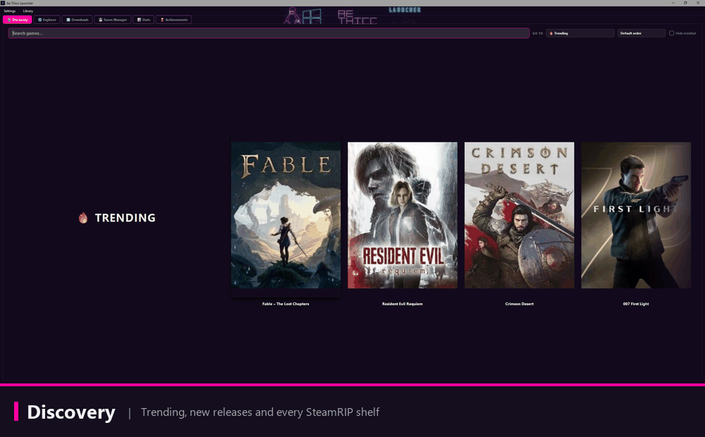
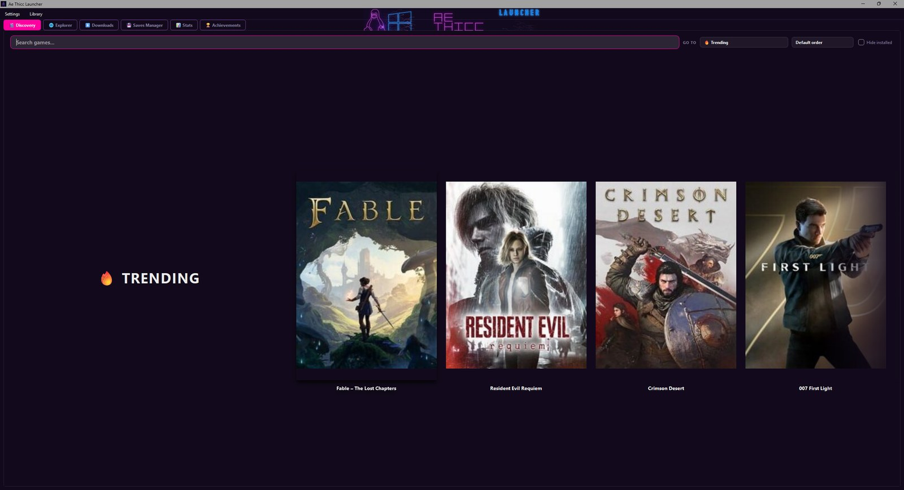
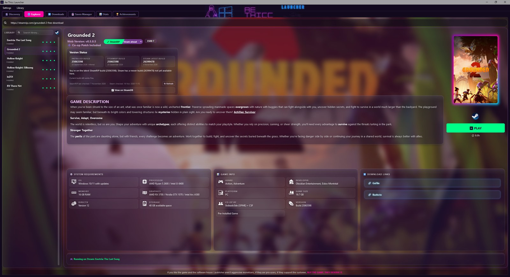
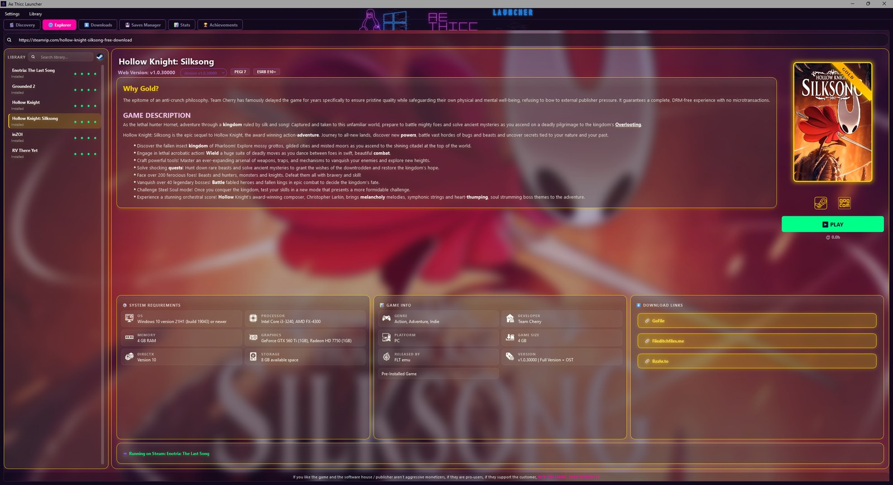
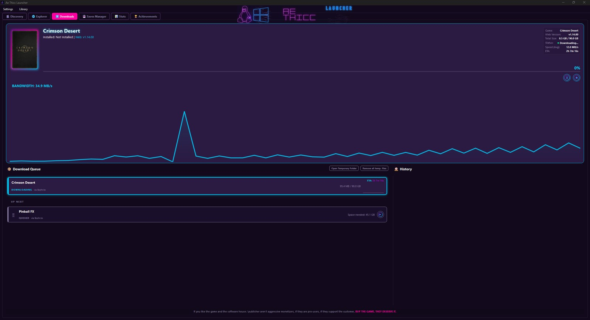
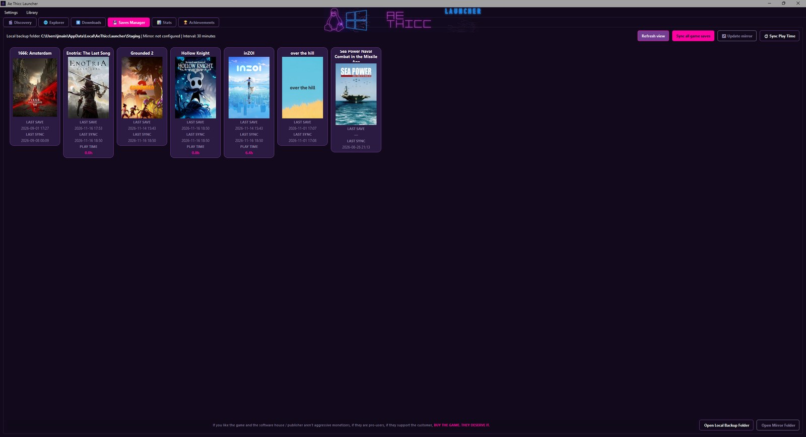
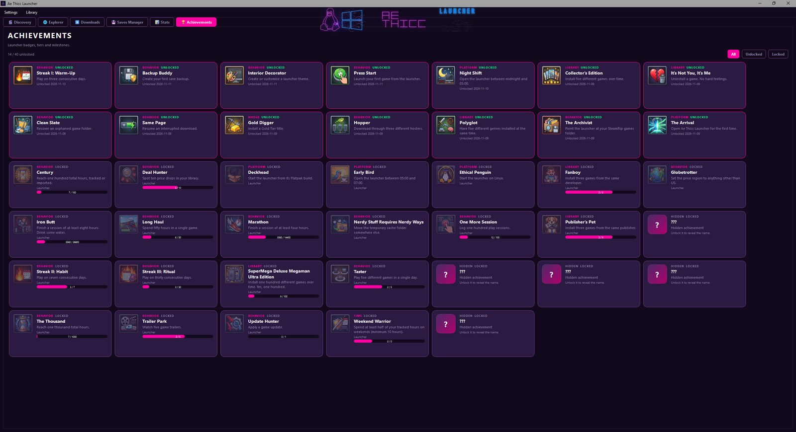
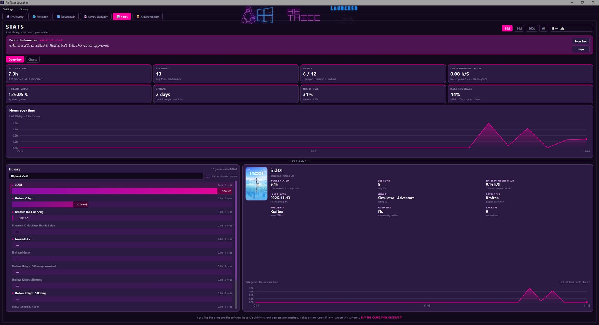

 <p align="center">
   
 </p>

# Ae Thicc Launcher

<a href="https://github.com/Shady-Unknown/AeThiccLauncher/releases/latest"></a>

**Ae Thicc Launcher** is an unofficial desktop client for SteamRIP: browse the catalogue like a streaming service, download and update games, keep every savegame backed up, and see what you actually play.

**Not just another downloader.** Games deserve to outlive storefronts: keep what you can't buy anymore (or can't afford yet) playable, keep the saves that make it yours, and **pay for the games that respect you**.

It runs on Windows and Linux (including Steam Deck and Flatpak), keeps its data local, and works without any bundled API key. Optional SteamGridDB/IGDB keys unlock extra artwork and the two IGDB shelves.

<br clear="both" />

## Contents

- [About](#about)
- [Community](#community)
- [Installation](#installation)
  - [Windows](#windows)
  - [Linux / Flatpak](#linux--flatpak)
  - [Data and library locations](#data-and-library-locations)
- [Key features](#key-features)
- [Screenshots](#screenshots)
- [Getting started](#getting-started)
- [Optional API keys (SteamGridDB / IGDB)](#optional-api-keys-steamgriddb--igdb)
- [ffmpeg on Linux](#ffmpeg-on-linux-trailer-seeking)
- [Technical notes for power users](#technical-notes-for-power-users)
- [Upcoming](#upcoming)
- [Changelog](#changelog)

## About

This launcher doesn't just have an aesthetic; it has a **purpose**.

In an industry increasingly dominated by the **aggressive monetization** of big corporations, **game preservation** and accessibility have never been **more critical**. **Ae Thicc Launcher** was built to ensure that everyone, regardless of their current financial capability, can access, play, and retain the games they love. We care deeply about true software ownership, giving you the tools to preserve your game files and your hard-earned savegames forever.

However, this freedom comes with a strong moral compass. We believe in voting with our wallets and supporting those who respect the medium. Our core motto, and the driving force behind this project, is simple:

> **"If a Developer or Publisher isn't aggressively monetizing, if they care about the customer and support them, THEN BUY THE GAME. THEY DESERVE IT."**

While many of our ethical features are still actively being developed behind the scenes, everything we build aims to strike this balance: do what you want with YOUR software, but always remember to reward the non-toxic, passionate developers who make this industry great.

## Community

<a href="https://discord.gg/4WF7YU3ynC"></a>

**Join the Ae Thicc Launcher Discord**. Get help with setup, report bugs, suggest features, or just hang out and talk games.

**[discord.gg/4WF7YU3ynC](https://discord.gg/4WF7YU3ynC)**

<br clear="both" />

## Installation

Grab the latest release from the [releases page](https://github.com/Shady-Unknown/AeThiccLauncher/releases/latest).

### Windows

_Run the `Ae_Thicc_Launcher_Setup.exe` installer (or use the portable zip) and launch the app. The installer puts the application in the standard Programs folder (`C:\Program Files\AeThiccLauncher`) and asks for the usual UAC elevation; it does not install anything in AppData._

_Runtime data/cache stays in `%LOCALAPPDATA%\AeThiccLauncher` (the historical location); the default game library is `C:\SteamRip`. On first run the setup wizard shows these defaults and lets you move data, cache or library to another drive or separate paths if you prefer._

_If Windows SmartScreen or your antivirus flags the launcher, allow `Ae_Thicc_Launcher.exe`. Malwarebytes in particular may block `steamrip.com` as a website (not as a file): add an exception for the launcher and for `steamrip.com` if you want Discovery to load._

### Linux / Flatpak

```bash
flatpak install --user Ae_Thicc_Launcher_Linux.flatpak
```

Trailers play out of the box; for smooth seeking inside the sandbox, see [ffmpeg on Linux](#ffmpeg).

### Data and library locations

Defaults:

- **Application:** `C:\Program Files\AeThiccLauncher` on Windows (removed on uninstall).
- **Data/cache:** `%LOCALAPPDATA%\AeThiccLauncher` on Windows; the XDG data directory on Linux/Flatpak, with the historical `~/.cache/AeThiccLauncher/downloads` preserved unless you pick a custom root.
- **Game library:** `C:\SteamRip` on Windows, `~/SteamRip` on Linux/Flatpak.

On first run the wizard asks for:

- **Data & cache folder:** config, catalog, covers, stats, logs and temp files.
- **Game libraries:** one or more folders scanned for installed games and offered as install destinations (the default `SteamRip` folder is preselected, and you can add one on another drive).

You can change them later from **Settings → Run setup wizard**. A bootstrap file `aethicc.paths.json` records a data root only when you move it away from the default; if the install folder is read-only (for example `/app` inside Flatpak, or `Program Files` on Windows) it is written to the user data directory instead. Existing data in the old location is offered as an optional copy (nothing is deleted).

## Key features

### Discovery

*   **Doomscroll the catalog:** a single-row horizontal scroller that never ends. Pick a category, keep scrolling, find the game you'll install at 3 AM.
*   **Per-category browsing:** Trending, New Releases, Recently Added, Recently Updated and every SteamRIP category, one at a time, with a jump selector when you already know where to go.
*   **Search anything:** type a few characters and get one row with every matching game across the whole catalog.
*   **All games:** the entire catalog in one endless row, newest SteamRip releases first: nothing is left out, even the oldest titles.
*   **Sort where it makes sense:** Trending and My Library can be ordered by title, SteamRip added date, release date or rating. Date-based rows (New Releases, Recently Added/Updated, the SteamRIP categories and All Games) always keep their own order.
*   **Game cards:** one click opens the full sheet: cover, rating, genres, themes, game modes, developer, publisher, platforms, description, PEGI/ESRB age ratings and SteamRIP vs Steam build.
*   **Install in one click:** the *Install* button opens the game in the Games Explorer with its download links ready.
*   **Built-in trailer player:** fullscreen, volume, mute and smooth seeking; trailers are cached locally, so repeat views start instantly.

### Smart Explorer & Downloader

*   **Integrated Catalog:** Instantly search through the entire SteamRIP database with a lightning-fast auto-completing search bar.
*   **Cloudflare Bypass:** A stealthy, built-in browser handles Cloudflare challenges automatically whenever possible, so your downloads never get stuck.
*   **Smart Resume**: if the provider supports it you can resume your download, even between sessions. Low bandwidth? Latency or unstable connections? We got it. Just press "play" again and the download will resume from where it stopped
*   **Provider-aware queue:** one row per archive, the provider is shown in the queue, and re-adding the same game refreshes the existing task instead of duplicating it.
*   **Incomplete-download guard:** truncated archives are detected before extraction, kept resumable, and never offered as if they were complete.
*   **Auto-Extraction & Installation:** Games are downloaded, automatically extracted, and neatly placed into your designated "Game Libraries".

### Stats & Achievements

*   **Stats overview:** real local data for hours, sessions, streaks, Entertainment Yield (hours played per dollar of reference price), library value, developers, publishers and genres.
*   **Charts:** 52-week activity heatmap, hours by time of day and weekday, session lengths, genre donut, top developers and a highest/lowest Entertainment Yield ranking.
*   **Per-game browser:** searchable and sortable library with covers, selected-game metrics, playtime chart and a rotating advice banner.
*   **Launcher achievements:** 40 data-driven achievements with unlock toasts, retroactive evaluation, hidden entries, filters and progress bars.
*   **Achievement popup:** full-window dimmed overlay with the large icon, status/date and progress; close with Esc or a click outside the card.
*   **No progress fuss:** unlocks are idempotent, progress is recalculated from real library data, and there is no destructive reset button in the UI.

### Advanced Library Management

*   **Orphan Recovery:** Found an old folder? The launcher can automatically scan it, fetch the correct metadata from the web, and populate it into your library.
*   **Update Checker:** Compares your local game version against the web version. If a new update is available, it notifies you and helps you download the games directly (no patch files supported now, unless specified by the host game's page)
*   **Digital Store Links:** Automatically grabs official Steam and GOG store links so you can check out the official pages.
*   **Steam Sales Mirror:** You got that game in your library. It's SO GOOD! And the devs? You heard great about them. We'll let you know when that piece of art is for sale on **STEAM** and/or **GOG** (nope, F* off Epic)
*   **Gold Tier:** Games from known Software Houses, verified by the community, in which you can rely forever. Non Toxic, Non Predatory, Quality made games that deserves a spotlight

### Savegames Manager

*   **Ludusavi Integration:** Automatically fetches game informations to locate exactly where your game saves are stored, both for Windows and Linux (Proton) prefixes.
*   **Automated Backups:** Set a sync interval or let the launcher do the work. The built-in **Process Monitor** detects when you close a game and immediately backs up your latest save securely.
*   **Versioned snapshots:** a rotating history per game (default 5, configurable), each one with version, reason, device and date.
*   **Safe restore:** snapshots the current saves before restoring, swaps atomically, rolls back on failure and refuses unsafe destinations.
*   **Mirror:** copies the backups incrementally to a second folder (another drive, a network share, a Syncthing/Drive folder) and never deletes anything.
*   **Launcher data backup:** achievements, stats and preferences are backed up too, and restores are additive (local data wins).

### Steam Integration & Linux/Deck Support

*   **One-Click Steam Injection:** Add your non-Steam games directly into your Steam Library with a single click.
*   **Add All to Steam:** a single Library-menu action adds every installed game that is still missing a shortcut, closing and restarting Steam only once.
*   **Automated Artwork:** The launcher downloads and applies Covers, Heroes, and Logos to your Steam Library entries dynamically!
*   **Proton Ready:** On Linux/Steam Deck, the launcher automatically configures Steam shortcuts to use `Proton GE` or `Proton Experimental`, getting you ready to play immediately.

## Screenshots

A quick tour of the launcher. Click a shot to open it full size.

<table>
  <tr>
    <td><a href="https://raw.githubusercontent.com/Shady-Unknown/AeThiccLauncher/main/docs/screenshots/01-discovery.jpg"></a><br><b>Discovery</b>: Trending, new releases and every SteamRIP shelf</td>
    <td><a href="https://raw.githubusercontent.com/Shady-Unknown/AeThiccLauncher/main/docs/screenshots/02-explorer.jpg"></a><br><b>Explorer</b>: Search, game sheet, hosts and version status</td>
  </tr>
  <tr>
    <td><a href="https://raw.githubusercontent.com/Shady-Unknown/AeThiccLauncher/main/docs/screenshots/03-gold-tier.jpg"></a><br><b>Gold Tier</b>: Community-verified studios and quality picks</td>
    <td><a href="https://raw.githubusercontent.com/Shady-Unknown/AeThiccLauncher/main/docs/screenshots/04-downloads.jpg"></a><br><b>Downloads</b>: Queue, speed graph and automatic extraction</td>
  </tr>
  <tr>
    <td><a href="https://raw.githubusercontent.com/Shady-Unknown/AeThiccLauncher/main/docs/screenshots/05-savegames.jpg"></a><br><b>Savegames</b>: Versioned backups with safe restore</td>
    <td><a href="https://raw.githubusercontent.com/Shady-Unknown/AeThiccLauncher/main/docs/screenshots/06-achievements.jpg"></a><br><b>Achievements</b>: 40 unlocks with progress and toasts</td>
  </tr>
  <tr>
    <td><a href="https://raw.githubusercontent.com/Shady-Unknown/AeThiccLauncher/main/docs/screenshots/07-stats.jpg"></a><br><b>Stats</b>: Hours, sessions and Entertainment Yield</td>
    <td></td>
  </tr>
</table>

## Getting started

1.  **First-run wizard:** choose the data/cache folder and at least one **Game Library** (e.g. `C:\Games`, `L:\AeThiccLibrary` or `/home/deck/Games`). The launcher scans libraries for installed games and uses the default one for new downloads/extractions. You can re-run the wizard from **Settings → Run setup wizard**.
2.  **Configure Save Sync Folder:** In the settings, designate a folder where your savegame backups will be stored (default no forced designation, it has a default path OS based)
3.  **Search & Play:** Go to the Explorer tab, type a game name or paste a VALID URL (wink wink), hit Enter, and let the launcher do the heavy lifting!

## Optional API keys (SteamGridDB / IGDB)

The launcher works without any API key. If you want the extra metadata:

- **SteamGridDB** (grids, heroes, logos): create a personal key from your SteamGridDB profile and paste it in the first-run wizard or **Settings → API Keys**.
- **IGDB / Twitch** (Trending and New Releases): create a Twitch application and paste the client ID + client secret in the same page. Without it those two rows are hidden.

Keys are stored in the OS keychain (Windows Credential Manager / Secret Service on Linux); if the keychain is unavailable, the launcher falls back to a protected file in its data folder. Keys are never written to `config.json` and never logged. Changes in Settings are applied after a restart.

## ffmpeg on Linux (trailer seeking)

Trailers play out of the box. To also get smooth seeking on Linux, install `ffmpeg` with your distribution's package manager:

| Distribution | Command |
|---|---|
| Debian / Ubuntu / Mint / Pop!_OS | `sudo apt install ffmpeg` |
| Fedora | `sudo dnf install ffmpeg` |
| Arch / Manjaro / EndeavourOS | `sudo pacman -S ffmpeg` |
| openSUSE | `sudo zypper install ffmpeg` |

On **Steam Deck (SteamOS)** the system is immutable: use `sudo steamos-readonly disable && sudo pacman -S ffmpeg && sudo steamos-readonly enable` (it may need to be repeated after a SteamOS update), or run the launcher from a distrobox/container that has ffmpeg.

On **Windows** nothing is needed: the launcher bundles what it requires.

In the **Flatpak** build the launcher runs inside a sandbox: seeking works if `ffmpeg` is available there, otherwise the trailer streams normally without seeking.

## Technical notes for power users

*   **Metadata:** Game metadata is stored locally inside each game's folder in a `steamrip_meta.json` file. You can back up your games just by moving the folder; the launcher will recognize them instantly on the next scan.
*   **Data & seed:** the `data/`, `bin/`, `.media/`, `_internal/` and `lists/` folders next to the executable are implementation details and hidden in the installer. They are seeds: definitions, icons, phrase packs and the posts index are copied into the data root chosen in the first-run wizard, and the launcher reads them only from there.
*   **API keys:** stored in the OS keychain or the encrypted fallback file. They are never written to `config.json` or logs.
*   **Logs and diagnostics:** `<data root>/logs/launcher.log` keeps a rotating history (2 MB x 3) and `crash.log` records uncaught exceptions. **Settings -> Diagnostics** opens them or copies a redacted summary. Run the launcher with `--console` (or `AETHICC_CONSOLE=1`) and `AETHICC_LOG_LEVEL=DEBUG` for live troubleshooting; logs never contain API keys.
*   **Cache:** The Master Catalog caches locally and updates in the background to prevent unnecessary network requests.
*   **Network Drops:** The smart downloader supports resume functionality. If your connection drops, it will automatically attempt to resume up to 10 times. Results may vary depending on hosts.
*   **Trailers:** the first time a trailer is opened it is prepared in a local cache so seeking is instant and repeat views start immediately. On Windows the needed tool is bundled; on Linux install `ffmpeg` (see above) to enable seeking.

## Upcoming

*   **Cloud Saves Sync**: Having your games saved on the cloud (your own personal GDrive or similar) will make things twice as easy once you format, or move on with different games. The local backup, mirror and restore flows already share the backend that a remote provider will plug into.

## Changelog

**v1.9.7 (2026-11-24):** the Explorer shows a glass status strip with the library indicators and an IGDB rating pill that opens Metacritic reviews; the library sidebar lists titles only; the ethical footer appears on every tab and the window title shows the version.

Every release (with the full list of changes, notes and downloads) lives in **[CHANGELOG.md](CHANGELOG.md)** and on the **[GitHub Releases page](https://github.com/Shady-Unknown/AeThiccLauncher/releases)**.
